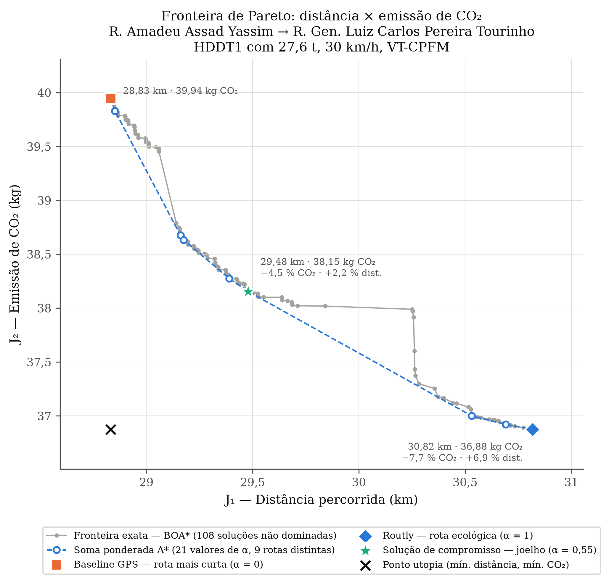
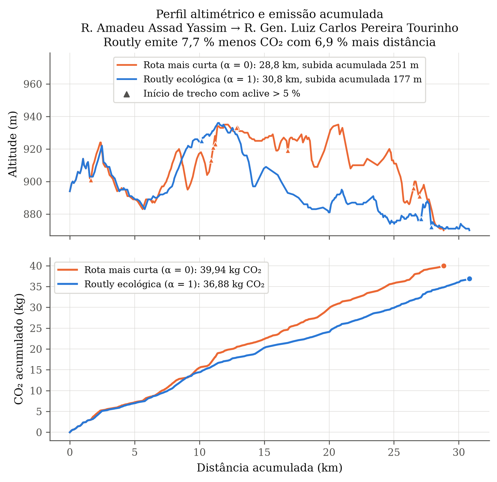
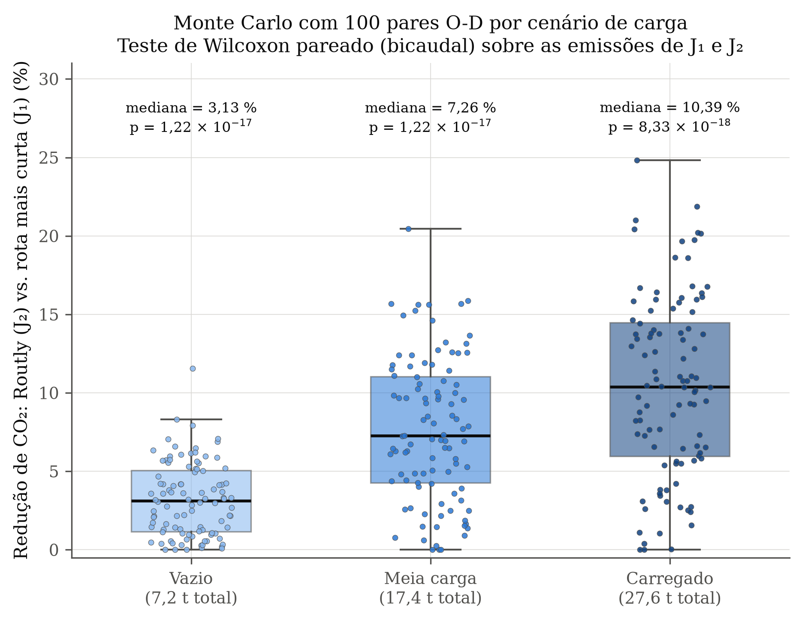
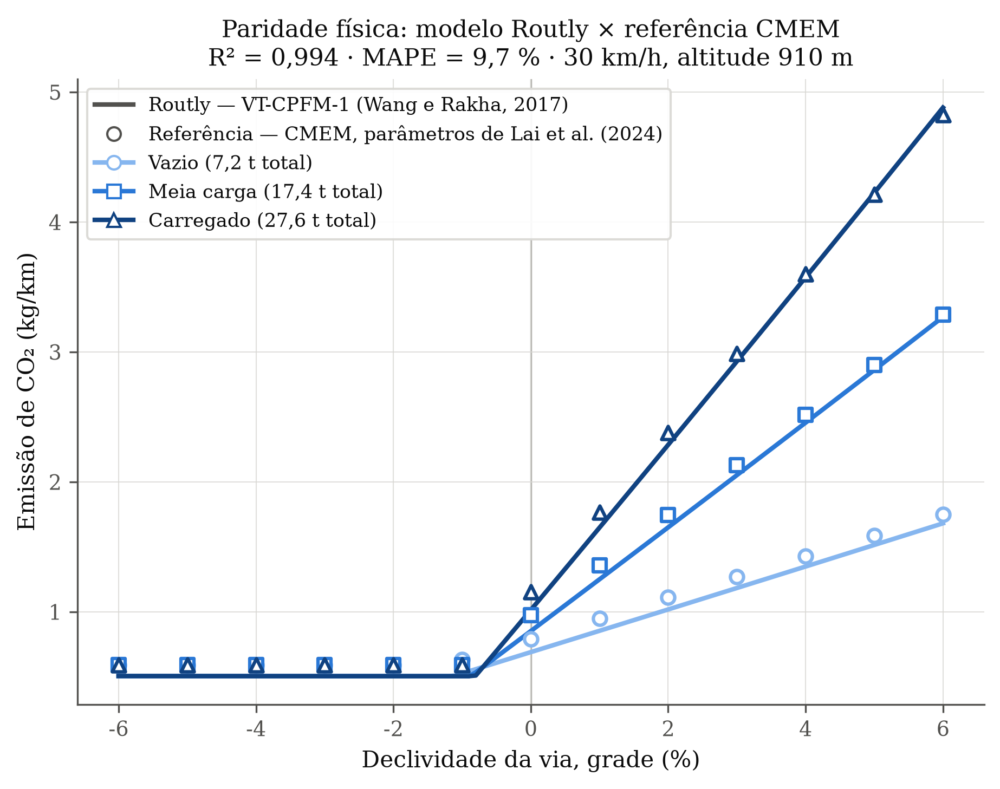

# Routly — Rotas ecológicas para caminhões em Curitiba

**Grupo:** Alex Menegatti Secco, Gabriel Marques Simini, Mariana de Castro, Vitor Rodrigues Izidoro
**Repositório:** https://github.com/Vitor-Izidoro/Routly · **Revisão:** 06/11/2026

Este documento descreve o projeto e lista **todos os artefatos entregues** (dados, código-fonte,
testes, logs, resultados e figuras), com o papel de cada um e os parâmetros usados para gerá-los.
Todos os caminhos são relativos à raiz do repositório. O arquivo `readme.txt` é uma cópia idêntica
deste documento.

## Sumário

**Projeto**
1. [Descrição e escopo](#1-descrição-e-escopo)
2. [Guia rápido para avaliação](#2-guia-rápido-para-avaliação)
3. [Interface gráfica (painel web)](#3-interface-gráfica-painel-web)
4. [Materiais e métodos](#4-materiais-e-métodos)

**Artefatos**

5. [Estrutura do repositório](#5-estrutura-do-repositório)
6. [Dados](#6-dados)
7. [Código-fonte e parâmetros de execução](#7-código-fonte-e-parâmetros-de-execução)
8. [Testes automatizados](#8-testes-automatizados)
9. [Resultados, figuras e logs](#9-resultados-figuras-e-logs)
10. [Documentação complementar](#10-documentação-complementar)

**Conclusões**

11. [Principais resultados](#11-principais-resultados)
12. [Limitações](#12-limitações)
13. [Cronograma](#13-cronograma)
14. [Referências](#14-referências)

---

## 1. Descrição e escopo

**Contexto.** GPSs tradicionais calculam a rota mais rápida ou mais curta e ignoram o relevo.
Em cidades com variação de altitude como Curitiba, subidas íngremes aumentam muito o esforço
do motor de um caminhão e, com ele, a emissão de CO₂.

**Proposta.** O Routly é um motor de roteamento multiobjetivo que cruza a malha viária e a
altimetria oficiais de Curitiba (IPPUC) com um modelo físico de consumo de caminhão diesel.
Para uma origem e um destino (nomes de ruas), ele calcula:

- a **rota mais curta** (o que um GPS comum faria);
- a **rota de menor emissão de CO₂** (a rota ecológica do Routly);
- as **alternativas intermediárias** da fronteira de Pareto distância × emissão, com uma
  solução de compromisso (joelho de Pareto).

O usuário escolhe carga do caminhão, velocidade, modelo de emissão e fator de conversão de CO₂.
A saída inclui instruções passo a passo, mapa e métricas de cada rota.

**Sobre "modelos treinados".** O projeto é determinístico (teoria dos grafos + modelos físicos):
não há treinamento nem pesos. O equivalente ao modelo do sistema é (a) o grafo pré-processado
`grafo_curitiba_carbono.csv` e (b) os parâmetros físicos do caminhão, publicados em `vtcpfm.py`,
`emissoes.py` e `veiculos.py`, com as fontes em `docs/`.

---

## 2. Guia rápido para avaliação

**Pré-requisitos:** Python 3.10 ou superior (testado com 3.13.6). Node.js é opcional (só para os
testes do painel web).

**Instalação** — uma única vez, num terminal aberto na pasta onde o projeto ficará:

```powershell
git clone https://github.com/Vitor-Izidoro/Routly.git
cd Routly
python -m venv .venv
.\.venv\Scripts\Activate.ps1                 # Windows (PowerShell); no cmd: .venv\Scripts\activate.bat
# source .venv/bin/activate                  # Linux/macOS
python -m pip install -r requirements.txt
```

Se o PowerShell bloquear o `Activate.ps1`, rode antes
`Set-ExecutionPolicy -Scope Process Bypass` (vale só para aquela janela).
**Todos os comandos `python` deste documento supõem o ambiente ativado e o terminal na pasta
`Routly/`.** Ao abrir um terminal novo, repita apenas `cd Routly` e a linha de ativação.

**Primeiro uso — dois caminhos equivalentes:**

```bash
python main.py          # menu no terminal (seção 7.1)
python interface.py     # painel no navegador (seção 3)
```

**Reproduzir todos os resultados de `resultados_validacao/`** (cerca de 6 minutos):

```bash
python main.py --opcao 3.6 --pares 100
python -m experimentos.teste_exaustivo_rotas --semente 42 --carga Carregado --boxplots
```

**Rodar os testes:**

```bash
python -m pytest tests -v                        # 72 testes + 122 subtestes
node --test tests/frontend/preview.test.cjs      # 6 testes do painel web
```

**Parâmetros comuns a todos os experimentos** (salvo indicação em contrário):

| Parâmetro | Valor |
|---|---|
| Caminhão | HDDT1 — International 9800 SBA (1997), Cummins M11-330; massa base 7.182 kg; 330 hp (246,1 kW); área frontal 10 m²; Cd 0,78 |
| Cenários de carga (reboque + carga) | Vazio = 0 kg · Meia carga = 10.205,8 kg · Carregado = 20.411,7 kg |
| Operação | Velocidade constante de 30 km/h, aceleração zero, sem tráfego ou semáforos |
| Modelo de emissão | VT-CPFM-1 (Wang e Rakha, 2017) |
| Fator de CO₂ | EPA: 2.697,20 g de CO₂ por litro de diesel |
| Semente aleatória | 42 (mesmos pares origem-destino a cada execução) |
| Par de referência | R. AMADEU ASSAD YASSIM → R. GEN. LUIZ CARLOS PEREIRA TOURINHO |

---

## 3. Interface gráfica (painel web)

O painel é a forma mais simples de usar o Routly: executa no navegador as mesmas operações do menu
`main.py`, com formulários no lugar das perguntas do terminal. Roda apenas no seu computador
(endereço `127.0.0.1`, sem acesso externo) e não exige programas além dos do `requirements.txt`.

### Como abrir e fechar

```bash
python interface.py           # ou: python main.py --interface
```

Com o ambiente ativado (seção 2), o navegador abre sozinho em **http://127.0.0.1:8765**. Para usar outra porta ou não abrir o
navegador: `python interface.py --porta 8766 --sem-abrir`. Para encerrar, pressione **Ctrl+C** no
terminal onde o painel foi iniciado; execuções em andamento também são encerradas.

### Partes da tela

| Região | O que faz |
|---|---|
| **Barra lateral** | Escolhe o grupo de operações (lista abaixo). Também dá acesso a **Resultados salvos** e ao **Histórico de execuções**. |
| **Topo** | Mostra se o painel está conectado. O botão **Executar suíte de testes** roda todo o pytest; **Comprovação completa** abre o pipeline 3.6. |
| **Indicadores** | Número de grupos e de operações, se a malha de Curitiba (`grafo_curitiba_carbono.csv`) foi encontrada e o estado da fila. |
| **Cartões do grupo** | Uma operação por cartão, com campo de busca. **Executar** inicia direto; **Configurar** abre um formulário de parâmetros antes. **O que este teste comprova?** abre um guia com objetivo, procedimento, como interpretar e limites da conclusão, sem executar nada. **Executar grupo** enfileira as operações individuais do grupo (suítes completas, pipeline e ETL ficam de fora, para evitar duplicação). |
| **Execuções e resultados** | À esquerda, as últimas execuções com seu estado. À direita, a execução selecionada em três abas: **Resultados** (gráficos, mapas, tabelas e relatórios, com prévia e download), **Terminal** (saída completa, ao vivo, com download do log) e **Parâmetros** (valores usados). |

### Grupos e equivalência com o menu do terminal

| Grupo | Operações | Menu |
|---|---|---|
| Testes automatizados | Suíte completa (pytest), suíte unittest e cada arquivo de `tests/` separadamente | 3.2 |
| Validação de modelos | Validação integrada, conversão de CO₂, paridade física, reprodução do CMEM, eficácia em três camadas | 3.1 |
| Análises científicas | Comparação de rotas, fronteira de Pareto, perfil altimétrico, Monte Carlo + Wilcoxon, comprovação completa | 3.3–3.6 |
| Roteamento | ALT (menor distância e menor emissão), BOA\*, NBA\*, com todos os parâmetros do `executar.py` | 2.x |
| Dados e mapas | Mapa interativo, cruzamentos, malha viária, inspeção dos shapefiles, gerar grafo do IPPUC, lote de 100 rotas | 1.1–1.3, 3.7 |

### Passo a passo de uma execução

Exemplo com a fronteira de Pareto:

1. Na barra lateral, clique em **Análises científicas**.
2. No cartão **Fronteira de Pareto**, clique em **O que este teste comprova?** se quiser ler o guia
   e depois em **Configurar**.
3. Ajuste origem, destino, cenário de carga e passos de α (os padrões reproduzem os resultados
   entregues) e clique em **Iniciar execução**.
4. A execução aparece na lista com o estado **Na fila → Executando → Concluído** (ou **Falhou** /
   **Cancelado**). A fila executa uma operação por vez, cada uma em um processo separado.
5. Acompanhe a saída na aba **Terminal**. Ao terminar, a aba **Resultados** mostra a figura
   `pareto_fronteira.png`, o CSV e as métricas, que podem ser abertos em prévia ou baixados.
6. Use **Cancelar** para interromper uma execução, ou **Repetir ↻** para rodá-la de novo com os
   mesmos parâmetros.

### Onde ficam os arquivos

- Cada execução do painel grava seus arquivos em `.routly/runs/<id>/` (pasta local, não versionada).
  Execuções do painel **não** sobrescrevem `resultados_validacao/`.
- **Resultados salvos** abre os arquivos de referência de `resultados_validacao/` (os resultados
  desta entrega) sem executar nada. É o caminho mais rápido para conferir figuras, tabelas e logs.
- Se o painel for fechado com execuções pendentes, elas aparecem como **Interrompido** ao reabrir.
- Sem o grafo ou sem os shapefiles, os cartões que dependem deles indicam a ausência antes de executar.

Detalhes técnicos (arquitetura, segurança, limites de prévia): [docs/INTERFACE.md](docs/INTERFACE.md).

---

## 4. Materiais e métodos

1. **ETL espacial** (`etl_ippuc.py`). As extremidades de cada eixo de rua viram nós do grafo;
   a altitude de cada nó vem da curva de nível mais próxima (`geopandas.sjoin_nearest`, R-Tree).
   Cada aresta guarda distância, altitudes e desnível.
2. **Modelo de emissão** (`vtcpfm.py`, padrão). VT-CPFM-1 convexo de Wang e Rakha (2017):
   resistência aerodinâmica, de rolamento e de rampa → potência → vazão de diesel → CO₂.
   Velocidade constante, aceleração zero, altitude média por trecho. Como alternativas há o
   CMEM (Lai et al., 2024, `emissoes.py`) e a fórmula legada
   $C = d_{km} \cdot E \cdot (1 + 0{,}015\,\Delta Z^{+})$. Equações: [docs/VTCPFM.md](docs/VTCPFM.md)
   e [docs/MODELO_EMISSOES.md](docs/MODELO_EMISSOES.md).
3. **Busca de caminhos** (`algoritmos.py`).
   - **ALT** (A\* com landmarks e desigualdade triangular): ótimo exato por distância ou por emissão.
   - **BOA\*** (Hernández et al.): fronteira de Pareto completa distância × emissão.
   - **NBA\*** bidirecional (`estrela.py`): implementação original, mantida como opção legada.
4. **Análise multiobjetivo** (`experimentos/comprovacao_cientifica.py`), na linha de
   Reynoso-Meza: A\* com custo ponderado
   $C(e) = (1-\alpha)\,\hat d(e) + \alpha\,\hat E_{CO_2}(e)$, com α de 0 a 1 e objetivos normalizados
   pelos pontos utopia e nadir. A solução de compromisso é a mais próxima do ponto utopia.
5. **Validação estatística.** Monte Carlo com 100 pares origem-destino × 3 cargas, teste pareado
   de Wilcoxon, IC 95 % por bootstrap, medição cruzada no CMEM e sensibilidade a ruído na altitude.

---

## 5. Estrutura do repositório

```
Routly/
├── README.md / readme.txt      este documento (cópias idênticas)
├── main.py                     menu central (CLI) — ponto de entrada principal
├── executar.py                 roteamento de uma consulta (ALT, BOA*, NBA*)
├── interface.py, interface/    painel web local (http://127.0.0.1:8765)
├── algoritmos.py               ALT e BOA*
├── vtcpfm.py                   modelo VT-CPFM-1 (padrão)
├── emissoes.py                 CMEM e modelo legado
├── veiculos.py, cenarios_co2.py, dados_co2.py
├── estrela.py                  carregamento do grafo, NBA*, instruções e mapa
├── etl_ippuc.py                shapefiles IPPUC → grafo_curitiba_carbono.csv
├── mapa.py                     mapa interativo Leaflet e cruzamentos
├── grafo_curitiba_carbono.csv  grafo da malha de Curitiba (dado de entrada)
├── experimentos/               comprovação científica, eficácia, CO₂, lote de 100 rotas
├── tests/                      testes automatizados (pytest e Node.js)
├── resultados_validacao/       figuras, tabelas, relatórios e logs da comprovação
├── docs/                       documentação técnica
└── ver_grafo.py, ver_colunas.py, debug_nomes.py, teste_comparacao_rotas.py, validar.sh
```

---

## 6. Dados

| Artefato | Descrição e papel no projeto |
|---|---|
| `grafo_curitiba_carbono.csv` | Grafo da malha viária de Curitiba: 40.393 arestas, ~29,5 mil nós. Gerado por `etl_ippuc.py`; é a entrada de todos os algoritmos e experimentos. Colunas: `origem_x`, `origem_y`, `origem_z`, `destino_x`, `destino_y`, `destino_z` (SIRGAS 2000 / UTM 22S, em m; z = altitude em m), `distancia_m`, `delta_z` (desnível em m), `custo_carbono` (custo legado: distância + 5 × subida, usado só pelo modo legado e por `teste_comparacao_rotas.py`) e `nome_rua`. Versionado no repositório, apesar de constar no `.gitignore`. |
| Shapefiles do IPPUC (**não versionados**) | `EIXO_RUA_SIRGAS/EIXO_RUA.shp` e `ALT_CURVA_DE_NIVEL_SIRGAS/ALT_CURVA_DE_NIVEL.shp`. Dados primários para gerar o grafo; só são necessários para recriá-lo (opção 1.1). Para usá-los, extraia o `dados.rar` do Drive e coloque as pastas `EIXO_RUA_SIRGAS/` e `ALT_CURVA_DE_NIVEL_SIRGAS/` dentro da pasta do projeto (ou ao lado dela) e instale `geopandas` (`python -m pip install geopandas`). Download oficial: [IPPUC](https://ippuc.org.br/geodownloads/geo.htm) (projeção SIRGAS). Cópia congelada do grupo: [Google Drive](https://drive.google.com/file/d/1G_TyDlhXrZ-uHM17ONIaw-5KRDzijHaS/view?usp=sharing). |
| `CO2 Emissions_Canada.csv` (**não versionado**) | Catálogo canadense de veículos ([Kaggle](https://www.kaggle.com/datasets/debajyotipodder/co2-emission-by-vehicles)). Usado na validação do fator de CO₂ e no modelo legado. `dados_co2.py` faz o download e confere as colunas na primeira execução; o SHA-256 do arquivo usado fica em `resultados_validacao/conversao_co2/resumo.json`. |
| `docs/validacao_cmem.json` | Registro histórico (09/09/2026) de rotas, emissões e alternativas BOA\* calculadas com o CMEM, com o SHA-256 do grafo. Referência de reprodutibilidade. |

---

## 7. Código-fonte e parâmetros de execução

### 7.1 Pontos de entrada

**`main.py`** — menu central (CLI) que dá acesso a todas as funcionalidades.

```bash
python main.py                          # menu interativo
python main.py --opcao <código>         # executa uma opção sem menu
python main.py --opcao 3.6 --pares 100  # pipeline completo de comprovação
python main.py --interface              # abre o painel web
```

- `--opcao`: 1.1, 1.2, 1.3, 3.1, 3.2, 3.3, 3.4, 3.5, 3.6 ou 3.7.
- `--pares`: N de pares origem-destino do Monte Carlo (opções 3.5 e 3.6; padrão 100).

**Como navegar no menu interativo:**

1. O cabeçalho mostra `[OK]` ou `[AUSENTE]` para o grafo, os shapefiles, o catálogo de CO₂ e a
   pasta de resultados. Com o grafo `[OK]`, tudo exceto a opção 1.1 funciona.
2. Digite o código da opção (por exemplo `3.3`) e pressione Enter. A opção `2` abre o submenu
   de roteamento (2.1 a 2.6).
3. Cada pergunta mostra o valor padrão entre colchetes, como `Rua de origem [R. AMADEU ASSAD YASSIM]`;
   pressionar Enter aceita o padrão. Os padrões reproduzem os resultados entregues.
4. Digite `v` em qualquer pergunta para voltar ao menu anterior e `0` no menu principal para sair.
5. Figuras e relatórios são salvos em `resultados_validacao/`; o terminal mostra o caminho de
   cada arquivo (`[SALVO] ...`).

| Opção | Função |
|---|---|
| 1.1 | Recria o grafo a partir dos shapefiles do IPPUC (`etl_ippuc.py`); sem eles, mantém o CSV existente |
| 1.2 | Mapa interativo (HTML) das rotas curta, compromisso e ecológica (`mapa.py`) |
| 1.3 | Lista as ruas que cruzam uma rua (`mapa.py`) |
| 2.x | Roteamento: ALT distância/emissão, BOA\*, NBA\*, com todos os parâmetros do `executar.py` |
| 3.1 | Validação dos modelos: conversão de CO₂, eficácia em 3 camadas, registro CMEM, paridade física |
| 3.2 | Testes automatizados (pytest) |
| 3.3 | Fronteira de Pareto e joelho |
| 3.4 | Perfil altimétrico comparativo |
| 3.5 | Monte Carlo + Wilcoxon |
| 3.6 | Executa 3.1 a 3.5 e grava `resultados_validacao/RESUMO.md` |
| 3.7 | Lote de 100 rotas: mais econômica × compromisso × mais curta |

**`executar.py`** — roteamento de uma consulta origem-destino, com instruções passo a passo e mapa
matplotlib. Também acessível por `python estrela.py <parâmetros>`.

| Parâmetro | Significado |
|---|---|
| `--algoritmo {alt,boa,nba}` | Algoritmo; sem este parâmetro, abre o assistente interativo |
| `--modo {distancia,emissao}` | Objetivo do ALT/NBA\* (padrão `emissao`) |
| `--origem`, `--destino` | Nome exato das ruas (padrão: par de referência) |
| `--modelo-emissao {vtcpfm,cmem,legado}` | Modelo de emissão (padrão `vtcpfm`) |
| `--cenario-co2 {epa,artigo}` | `epa` = 2.697,20 g/L; `artigo` = 2.070 g/L (só VT-CPFM) |
| `--caminhao {hddt1,hdv-generico}` | Perfil físico; `hdv-generico` só com CMEM |
| `--carga-kg`, `--velocidade-kmh` | Massa adicional (padrão 0) e velocidade constante (padrão 30) |
| `--landmarks` | Landmarks do ALT (padrão 4) |
| `--rota` | Alternativa BOA\* a detalhar (começa em 1) |
| `--veiculo`, `--taxa-emissao` | Apenas no modelo legado (catálogo ou g/km) |
| `--sem-mapa` | Não abre a janela do mapa |

Exemplo (caminhão carregado, 30 km/h, VT-CPFM):

```text
$ python executar.py --algoritmo alt --modo emissao --carga-kg 20411.65665 --sem-mapa
ALT | 29471 nós | modelo vtcpfm
[RESULTADO] CO₂: epa (2697.20 g/L)
Pré-processamento ALT: 0.539 s
Consulta ALT: 0.130 s

Rota | Distância (km) | CO₂ estimado (g) | Diesel estimado (L)
   1 |         30.818 |         36875.21 |               13.672

Rota selecionada: 1 (286 nós)
-> Saia pela: R. MERCEDES SEILER ROCHA
-> Entre na: R. GUSTAVO RATTMAN
-> Entre na: R. FAGUNDES VARELA
...
-> [CHEGOU AO DESTINO]
```

**`interface.py` e `interface/`** — painel web local; uso descrito na
[seção 3](#3-interface-gráfica-painel-web). `python interface.py [--porta 8765] [--sem-abrir]`.

| Arquivo | Papel |
|---|---|
| `interface/servidor.py` | Servidor HTTP local, fila e histórico |
| `interface/worker.py` | Executa cada operação em um processo separado |
| `interface/catalogo.py` | Lista de operações e validação dos parâmetros |
| `interface/static/` | HTML, CSS e JavaScript do painel |

As execuções do painel são gravadas em `.routly/runs/<id>/` (não versionado).
Documentação: [docs/INTERFACE.md](docs/INTERFACE.md).

### 7.2 Núcleo (modelos e algoritmos)

| Arquivo | Papel |
|---|---|
| `algoritmos.py` | ALT (A\* com landmarks, classe `IndiceALT`) e BOA\* (fronteira de Pareto exata, Hernández et al.) |
| `vtcpfm.py` | Modelo de consumo VT-CPFM-1 convexo para o HDDT1 (padrão) |
| `emissoes.py` | CMEM simplificado (Lai et al., 2024), modelo legado e validação de carga/velocidade |
| `veiculos.py` | Identificação física do caminhão de referência HDDT1 |
| `cenarios_co2.py` | Fatores de conversão de diesel em CO₂ (EPA e artigo) |
| `estrela.py` | Carregamento do grafo com custos por modelo, índice de ruas, NBA\* legado, instruções e mapa |
| `dados_co2.py` | Download e verificação do catálogo do Kaggle |
| `etl_ippuc.py` | ETL: shapefiles do IPPUC → `grafo_curitiba_carbono.csv`. Requer `geopandas`. `python etl_ippuc.py` |
| `mapa.py` | Mapa interativo Leaflet (HTML) e exploração de cruzamentos; converte UTM → lat/lon sem dependências extras |

### 7.3 Experimentos (`experimentos/`)

**`experimentos/comprovacao_cientifica.py`** — módulo principal de comprovação: fronteira de Pareto,
joelho, perfil altimétrico, Monte Carlo + Wilcoxon e paridade física VT-CPFM × CMEM.

```bash
python -m experimentos.comprovacao_cientifica --tudo | --modelos | --testes | --pareto | --perfil | --monte-carlo
       [--pares 100] [--semente 42] [--origem ...] [--destino ...]
       [--carga {Vazio,Meia carga,Carregado}] [--passos-alpha 21] [--sem-boa]
       [--saida resultados_validacao]
```

**`experimentos/avaliar_eficacia.py`** — eficácia em 3 camadas: (1) economia de CO₂ da rota
ecológica sobre a mais curta; (2) validação cruzada medindo as rotas no CMEM; (3) sensibilidade a
ruído gaussiano na altitude. No pipeline 3.6 roda com 100 pares, cargas 0 / 10.205,8 / 20.411,7 kg
e saída em `resultados_validacao/eficacia/`.

```bash
python experimentos/avaliar_eficacia.py [--pares 300] [--semente 42] [--cargas 0 10000 20000]
       [--velocidades 30] [--landmarks 8] [--ruido-m 1 2] [--sem-cmem] [--sem-graficos]
       [--saida experimentos/resultados]
```

**`experimentos/validar_conversao_co2.py`** — verificação de unidades (8 checagens) e comparação do
fator de CO₂ do projeto com os 175 veículos diesel do catálogo do Kaggle.

```bash
python experimentos/validar_conversao_co2.py [--dataset CAMINHO] [--saida PASTA]
```

**`experimentos/teste_exaustivo_rotas.py`** — lote de 100 consultas: compara rota mais econômica,
compromisso (joelho) e mais curta, com médias no terminal e, opcionalmente, CSV e boxplots.

```bash
python -m experimentos.teste_exaustivo_rotas [--carga Carregado] [--semente 42]
       [--origem ... --destino ...] [--boxplots] [--saida resultados_validacao/teste_exaustivo_rotas]
```

**`teste_comparacao_rotas.py`** (raiz) — exemplo ilustrativo com NetworkX: sorteia pares até achar
uma rota mais curta diferente da rota de menor custo legado (coluna `custo_carbono`) e compara
distância, subida acumulada e ruas. O custo legado é adimensional (não é g de CO₂).
`python teste_comparacao_rotas.py [--semente 42]`

### 7.4 Utilitários

| Arquivo | Papel |
|---|---|
| `ver_grafo.py` | Desenha toda a malha do grafo (matplotlib) |
| `ver_colunas.py` | Mostra as colunas do shapefile de ruas (requer `geopandas` e os shapefiles) |
| `debug_nomes.py` | Lista nomes de rua do grafo e colunas do shapefile |
| `validar.sh` | Laço de consultas repetidas pelo terminal (Linux/macOS, `.venv`) |
| `conftest.py` | Coloca a raiz do projeto no `sys.path` para o pytest |
| `requirements.txt` | Dependências: pandas, numpy, networkx, scipy, matplotlib, pytest; opcionais `geopandas` (ETL) e `PyQt6` (janelas) |

---

## 8. Testes automatizados

```bash
python -m pytest tests -v                        # 72 testes + 122 subtestes
node --test tests/frontend/preview.test.cjs      # 6 testes do painel
```

| Arquivo | O que verifica |
|---|---|
| `tests/test_algoritmos.py` | ALT e BOA\* contra enumeração exaustiva de caminhos |
| `tests/test_vtcpfm.py` | Equações do VT-CPFM recalculadas de forma independente |
| `tests/test_emissoes.py` | CMEM: relevo, carga, descida sem crédito, entradas inválidas |
| `tests/test_cenarios_co2.py` | Cenários EPA/artigo e a CLI do `executar.py` |
| `tests/test_conversao_co2.py` | Unidades, download do dataset e exportação |
| `tests/test_eficacia.py` | Regressão na malha real (20 pares): economia mínima, Wilcoxon p < 0,01, ALT = Dijkstra, confirmação no CMEM |
| `tests/test_comprovacao.py` | Menu, ETL sem shapefiles, A\* ponderado, joelho de Pareto, figuras e reprodução do registro CMEM |
| `tests/test_exaustivo_rotas.py` | Lote de 100 rotas e exportação de boxplots |
| `tests/test_interface.py` | Catálogo, parâmetros, fila, cancelamento e segurança do painel |
| `tests/frontend/preview.test.cjs` | JavaScript do painel (Node.js) |

Os testes conferem cada componente contra uma referência independente, nunca contra a própria
saída do código. Detalhamento das camadas de verificação: [docs/METODOS_DE_TESTE.md](docs/METODOS_DE_TESTE.md).

---

## 9. Resultados, figuras e logs

Pasta `resultados_validacao/`, gerada em 06/11/2026 pelos comandos do [guia rápido](#2-guia-rápido-para-avaliação),
com os parâmetros comuns da seção 2. Todos os sorteios usam semente 42: repetir os comandos
reproduz os mesmos números.

**Resumo e logs**

| Artefato | Descrição |
|---|---|
| `resultados_validacao/RESUMO.md` | Resumo consolidado do pipeline: lista de arquivos e métricas principais |
| `resultados_validacao/logs/pipeline_3.6_log.txt` | Log completo do terminal da execução do pipeline 3.6 |
| `resultados_validacao/logs/lote_100_rotas_3.7_log.txt` | Log completo do lote de 100 rotas (valores de cada teste e médias) |
| `resultados_validacao/testes_automatizados.txt` | Log do pytest executado pelo pipeline (72 aprovados, 122 subtestes) |

**3.1 — Validação dos modelos**

| Artefato | Descrição |
|---|---|
| `resultados_validacao/validacao_fisica_grade.png` | Figura: consumo/CO₂ por declividade (−6 % a +6 %), VT-CPFM × CMEM, 3 cargas |
| `resultados_validacao/paridade_fisica_grade.json` | Pontos e métricas da figura acima (R² = 0,994; MAPE = 9,7 %) |
| `resultados_validacao/conversao_co2/relatorio.md`, `resumo.json`, `diesel.csv` | Verificação de unidades (8/8) e fator de CO₂ implícito dos 175 veículos diesel |
| `resultados_validacao/reproducao_validacao_cmem.md` | Reprodução do registro `docs/validacao_cmem.json` (16/16 valores idênticos) |
| `resultados_validacao/eficacia/resumo.csv`, `pares.csv` | Eficácia em 3 camadas (100 pares): métricas por cenário e valores por par |
| `resultados_validacao/eficacia/histograma_economia.png`, `distancia_x_economia.png` | Figuras: distribuição da economia por carga; distância extra × economia |

**3.3 — Fronteira de Pareto** (par de referência, carregado, 21 passos de α)

| Artefato | Descrição |
|---|---|
| `resultados_validacao/pareto_fronteira.png` | Figura: distância (km) × CO₂ (kg), baseline (α = 0), Routly (α = 1), joelho e fronteira exata BOA\* |
| `resultados_validacao/pareto_tradeoff.csv` | Uma linha por α: distância, CO₂, % de CO₂ economizado, % de distância adicional, objetivos normalizados e solução de compromisso |

**3.4 — Perfil altimétrico**

| Artefato | Descrição |
|---|---|
| `resultados_validacao/perfil_altimetrico_comparativo.png` | Dois painéis: altitude e CO₂ acumulado × distância, rota mais curta vs. ecológica |

**3.5 — Monte Carlo + Wilcoxon** (100 pares × 3 cargas)

| Artefato | Descrição |
|---|---|
| `resultados_validacao/boxplot_cenarios_carga.png` | Figura: redução percentual de CO₂ por cenário de carga, com mediana e p-valor |
| `resultados_validacao/monte_carlo_resultados.csv` | 600 linhas (100 pares × 3 cargas × medido em VT-CPFM/CMEM): distâncias e CO₂ de J₁ (mais curta) e J₂ (ecológica) |
| `resultados_validacao/relatorio_estatistico.md` | Hipóteses, teste, IC 95 %, tamanho de efeito e avisos do modelo |

**3.7 — Lote de 100 rotas** (carregado, semente 42)

| Artefato | Descrição |
|---|---|
| `resultados_validacao/teste_exaustivo_rotas/rotas_100_testes.csv` | 300 linhas (100 testes × 3 alternativas): ruas, coordenadas, km, kg de CO₂ e percentuais |
| `resultados_validacao/teste_exaustivo_rotas/boxplots_rotas.png` e `.svg` | Boxplots de distância, CO₂, economia e distância adicional |

**Execução anterior (evidência complementar)**

| Artefato | Descrição |
|---|---|
| `experimentos/resultados/` (`resumo.csv`, `pares.csv`, 2 PNG) | `avaliar_eficacia.py` com seus padrões (300 pares, cargas 0/10.000/20.000 kg), executado em 05/10/2026 |

**Figuras principais**

| Fronteira de Pareto | Perfil altimétrico |
|---|---|
|  |  |
| **Redução de CO₂ por carga (Monte Carlo)** | **Paridade física VT-CPFM × CMEM** |
|  |  |

---

## 10. Documentação complementar

| Documento | Conteúdo |
|---|---|
| [docs/METODOS_DE_TESTE.md](docs/METODOS_DE_TESTE.md) | As 5 camadas de verificação e seus resultados |
| [docs/VTCPFM.md](docs/VTCPFM.md) | Equações, unidades e parâmetros do VT-CPFM |
| [docs/MODELO_EMISSOES.md](docs/MODELO_EMISSOES.md) | CMEM, modelo legado, fontes e limitações |
| [docs/CAMINHAO_REFERENCIA.md](docs/CAMINHAO_REFERENCIA.md) | Origem dos dados do caminhão HDDT1 |
| [docs/VALIDACAO_CONVERSAO_CO2.md](docs/VALIDACAO_CONVERSAO_CO2.md) | Metodologia da validação do fator de CO₂ |
| [docs/INTERFACE.md](docs/INTERFACE.md) | Uso do painel web e mapeamento para o menu |
| [experimentos/README.md](experimentos/README.md) | Uso dos experimentos de eficácia e do lote de 100 rotas |

---

## 11. Principais resultados

**Monte Carlo — 100 pares origem-destino, rota ecológica (J₂) × rota mais curta (J₁)**

| Cenário (massa total) | Redução mediana de CO₂ | IC 95 % | Medida no CMEM | Wilcoxon (p) |
|---|---|---|---|---|
| Vazio (7,2 t) | 3,13 % | 2,18–3,65 % | 2,17 % | 1,2 × 10⁻¹⁷ |
| Meia carga (17,4 t) | 7,26 % | 6,29–9,29 % | 5,55 % | 1,2 × 10⁻¹⁷ |
| Carregado (27,6 t) | 10,39 % | 9,19–12,18 % | 8,44 % | 8,3 × 10⁻¹⁸ |

- **Modelo físico:** VT-CPFM × CMEM em declividades de −6 % a +6 %: R² = 0,994, MAPE = 9,7 %.
- **Fator de CO₂:** média implícita de 2.688,6 g/L em 175 veículos diesel do Kaggle, a −0,32 % dos 2.697,2 g/L da EPA; 8/8 verificações de unidades.
- **Reprodutibilidade:** 16/16 valores do registro CMEM de setembro reproduzidos de forma idêntica.
- **Pareto (par de referência, carregado):** a rota mais curta tem 28,83 km e 39,94 kg de CO₂; a Routly, 30,82 km e 36,88 kg (−7,7 % de CO₂, +6,9 % de distância). O joelho (α = 0,55) dá −4,5 % de CO₂ com +2,2 % de distância. O BOA\* encontra 108 rotas não dominadas.
- **Perfil altimétrico:** subida acumulada de 251 m na rota curta contra 177 m na Routly; trechos com aclive > 5 %: 8 contra 3.
- **Lote de 100 rotas (carregado, médias):** rota ecológica −10,4 % de CO₂ / +6,4 % de distância; compromisso −7,4 % / +1,7 %.

---

## 12. Limitações

- A economia é **simulada**: velocidade constante, sem tráfego, semáforos ou paradas; todas as
  ruas são tratadas como mão dupla.
- A referência física (CMEM) é um modelo calculado, não medição de campo. A comprovação
  definitiva exigiria medir consumo real (OBD-II ou tanque cheio) em alguns pares.
- A altitude vem da curva de nível mais próxima. 98 trechos têm declividade acima de 20 %,
  provável erro de interpolação. Com ruído de ±2 m na altitude, a economia média cai de
  10,4 % para 4,8 %.
- Com 27,6 t, 1.968 arcos exigem potência acima da nominal do HDDT1 a 30 km/h; os custos não
  são limitados.

---

## 13. Cronograma

| Etapa | Atividade | Status |
| :--- | :--- | :--- |
| Fase 1 | Pesquisa de viabilidade e obtenção dos dados (IPPUC e Kaggle) | Concluído |
| Fase 2 | Pipeline ETL e interpolação espacial da altitude (R-Tree) | Concluído |
| Fase 3 | Algoritmo bidirecional NBA\* e geocodificador por nome de rua | Concluído |
| Fase 4 | Sistema multiobjetivo (distância × emissão): ALT e BOA\* | Concluído |
| Fase 5 | Consistência topológica (maior componente conexa, tratamento de ilhas) | Concluído |
| Fase 6 | Modelo de emissão baseado em artigos sobre caminhões (VT-CPFM, CMEM) | Concluído |
| Fase 7 | Especialização para caminhões (perfil HDDT1, cenários de carga) | Concluído |
| Fase 8 | Validação matemática e estatística das rotas, logs e resultados | Concluído |
| Fase 9 | Redação do documento final, formatação acadêmica e defesa | Em andamento |

---

## 14. Referências

- Wang, J.; Rakha, H. A. (2017). *Fuel consumption model for heavy duty diesel trucks: Model development and testing*. Transportation Research Part D. [DOI 10.1016/j.trd.2017.06.011](https://doi.org/10.1016/j.trd.2017.06.011)
- Lai et al. (2024). *The pollution-routing problem with speed optimization and uneven topography*. Computers & Operations Research. [DOI 10.1016/j.cor.2024.106557](https://doi.org/10.1016/j.cor.2024.106557)
- Bektaş, T.; Laporte, G. (2011). *The Pollution-Routing Problem*. Transportation Research Part B. [DOI 10.1016/j.trb.2011.02.004](https://doi.org/10.1016/j.trb.2011.02.004)
- Goldberg, A.; Harrelson, C. (2005). *Computing the shortest path: A\* search meets graph theory* (ALT). [PDF](https://www.microsoft.com/en-us/research/wp-content/uploads/2005/01/soda05.pdf)
- Hernández, C. et al. (2020). *A simple and fast bi-objective search algorithm* (BOA\*). [ICAPS](https://ojs.aaai.org/index.php/ICAPS/article/view/6655)
- EPA (2025). *Emission Factors for Greenhouse Gas Inventories*, tabela 2 (diesel: 10,21 kg CO₂/galão).
